# 🛡️ Cynbit Technologies: Backend Technical Audit & Hardened Architecture Reference
### Practical Technical Assessment for Backend Developer Intern Role

[](https://nodejs.org/)
[](https://cynbit-backend-audit.onrender.com)
[]()
[]()
[](https://datatracker.ietf.org/doc/html/rfc7807)
[](https://owasp.org/Top10/)
[](LICENSE)

> **Applicant / Lead:** Rituraj Tiwari  
> **Candidate Portal ID:** `cmtykw6c0000004igfwa7a18q`  
> **Target Role:** Backend Developer Intern  
> **Repository:** [https://github.com/riturajtiwari608-ai/cynbit-backend-audit](https://github.com/riturajtiwari608-ai/cynbit-backend-audit)  
> **Live Interactive Demo:** [https://cynbit-backend-audit.onrender.com](https://cynbit-backend-audit.onrender.com)  
> **Assessment Challenge:** *Analyze Cynbit From a Backend Perspective*  
> **Submission Deadline:** Sun, Nov 1, 04:02 AM  
> **Dedicated Submission Link:** [Cynbit Candidate Portal](https://www.cynbit.in/candidate/cmtykw6c0000004igfwa7a18q)  

---

## 📌 Executive Summary

**Cynbit Technologies** (`cynbit.in`) is a software solutions and AI automation firm headquartered in Jaipur, Rajasthan, operating under the mantra:  
> *"The Optimistic Architect: The Speed of a Startup, The Rigor of an Enterprise."*

This repository represents a complete, production-grade technical evaluation of Cynbit's observable web systems and talent acquisition endpoints. Conducted under **100% passive, authorized, and non-invasive testing protocols** (strictly observing RFC 9110 HTTP/1.1 semantics, response header telemetry, and DOM/RSC data serialization structures), this submission provides:

1. **Backend Technical Audit Report:** Deep-dive deconstruction of Next.js hybrid server-rendering, CUID primary key algorithms in Prisma ORM, and edge routing.
2. **Security & Performance Findings:** 6 categorized architectural vulnerabilities scored under CVSS v3.1 and mapped to OWASP Top 10:2021.
3. **Recommended Improvements & Architectural Blueprints:** Drop-in production TypeScript/Node.js code snippets addressing every identified vulnerability.
4. **Hardened Reference Implementation (PoC):** Fully functional, zero-dependency Node.js backend service demonstrating Zero-Trust Security Headers, Distributed Sliding-Window Rate Limiting, Cryptographic HMAC URL Signing, Anti-SSRF boundary validation, RFC 7807 Problem Details, and Database Circuit Breakers.
5. **Interactive Web Testing Console & Passive CLI Scanner:** A real-time test bench for live evaluation and benchmarking.

---

## 📑 Required Deliverables Quick Navigation

| Deliverable | File Path | Focus Area |
| :--- | :--- | :--- |
| **Deliverable 1: Backend Technical Audit Report** | [`BACKEND_TECHNICAL_AUDIT_REPORT.md`](BACKEND_TECHNICAL_AUDIT_REPORT.md) | Architectural analysis of observable backend behavior, Next.js App Router, Prisma CUID primary keys, and payload contracts. |
| **Deliverable 2: Security & Performance Findings** | [`SECURITY_AND_PERFORMANCE_FINDINGS.md`](SECURITY_AND_PERFORMANCE_FINDINGS.md) | Categorized findings across Security (SEC), Performance (PERF), Validation (DAT), and Resilience (RES). |
| **Deliverable 3: Recommended Improvements** | [`RECOMMENDED_IMPROVEMENTS.md`](RECOMMENDED_IMPROVEMENTS.md) | Production-ready architectural blueprints and drop-in code snippets for Next.js, Fastify/Express, and Prisma. |
| **Submission Portal Notes** | [`SUBMISSION_NOTES.md`](SUBMISSION_NOTES.md) | Formatted candidate setup notes ready for copy-pasting into the Cynbit submission portal. |

---

## 🏛️ System Architecture: Before vs After

```mermaid
flowchart TD
    subgraph ObservableCurrent ["1. Observable Current Architecture (cynbit.in)"]
        A1["Client Request\n(/candidate/cmtykw6c...)"] --> A2["Edge CDN Proxy\n(Partial Security Headers)"]
        A2 --> A3["Next.js Node / Serverless Runtime\n(RSC Flight Streams & Sharp Image Proxy)"]
        A3 --> A4["Prisma ORM Layer\n(CUID Primary Keys)"]
        A4 --> A5["Relational Database\n(Risk of Pool Starvation Under Burst)"]
    end

    subgraph ProposedHardened ["2. Proposed Cynbit Enterprise Architecture (PoC)"]
        B1["Signed Capability Request\n(/candidate/:cuid?exp=...&sig=...)"] --> B2["Zero-Trust Security Headers Middleware\n(CSP Nonces, HSTS Preload, NoSniff, Frame DENY)"]
        B2 --> B3["Distributed Sliding-Window Rate Limiter\n(RFC Headers: X-RateLimit-Limit, Retry-After)"]
        B3 --> B4["Boundary Zod Schema Validation\n(Anti-SSRF Domain Whitelist & Size Caps)"]
        B4 --> B5["Resilience Circuit Breaker\n(Guards Database Connection Pools)"]
        B5 --> B6["RFC 7807 Problem Details Handler\n(Zero Stack/Path Leaks in Production)"]
    end
```



---

## 🔍 Categorized Findings Summary

| ID | Domain | Vulnerability / Architectural Gap | CVSS | Severity | OWASP 2021 |
| :--- | :--- | :--- | :--- | :--- | :--- |
| **SEC-01** | Security | Missing Strict HTTP Defense Headers (CSP, HSTS Preload) | 5.3 | Medium | A05: Security Misconfiguration |
| **SEC-02** | Security/Auth | Insecure Direct Object Reference (IDOR) via Naked CUIDs | 6.5 | Medium | A01: Broken Access Control |
| **PERF-01** | Performance | Serverless Database Connection Exhaustion (Prisma Starvation) | 7.5 | High | A04: Insecure Design |
| **PERF-02** | Performance | Unrestricted Image Transcoding Computations (`/_next/image`) | 5.3 | Medium | Performance Bottleneck |
| **DAT-01** | Validation | Unbounded String Payloads & Downstream SSRF Risk | 7.2 | High | A03: Injection / A10: SSRF |
| **RES-01** | Resilience | Absence of Distributed Sliding-Window Rate Limiting | 6.5 | Medium | A04: Insecure Design |
| **RES-02** | Resilience | Inconsistent Error Envelopes & Risk of Stack/Path Leaks | 4.3 | Medium | A05: Security Misconfiguration |

---

## 🚀 Quickstart & Verification Guide

### 1. Prerequisites
* **Node.js**: `v18.0.0+` (tested on Node.js v20 LTS and v24)
* **npm**: `v9.0.0+`

### 2. Run Automated Test Suite
Verify all 7 unit and integration tests (zero external dependencies required):

```bash
npm test
```

Expected output:
```text
✔ CandidateValidator: validates authentic submissions and halts malicious inputs (6.3ms)
✔ CircuitBreaker: trips to OPEN after threshold and protects downstream resources (3.3ms)
✔ ErrorHandler: outputs RFC 7807 compliant problem details envelopes (8.2ms)
✔ ErrorHandler: sanitizes unhandled exceptions in production mode (0.6ms)
✔ SlidingWindowRateLimiter: strictly controls burst traffic and injects RFC headers (3.7ms)
✔ Security Headers Middleware: enforces defense-in-depth security policies (5.4ms)
✔ CandidateSecurityService: generates tamper-proof signed URLs and rejects alterations (4.6ms)
ℹ tests 7 | pass 7 | fail 0 | duration_ms ~290ms
```

### 3. Run Passive Security Audit Inspector
Execute our automated CLI audit scanner evaluating headers against OWASP benchmarks:

```bash
npm run audit
```

Expected output:
```text
📊 Hardened Architecture Baseline Benchmark:
   Security Score : 100 / 100
   Security Grade : A+
   Inference Time : 4.2ms
   All 7 OWASP Defense-in-Depth checks are passing with 100/100.
```

### 4. Launch the Interactive Web Dashboard
Start the reference HTTP server and open the testing console in your browser:

```bash
npm start
```
> Open [http://localhost:3000](http://localhost:3000) in your browser.

#### Features Available in the Web Console:
* **Live API Test Bench:** Submit candidate payloads and inspect RFC 7807 JSON telemetry.
* **Burst Rate Limiting Simulator:** Sends 6 rapid requests to visually demonstrate HTTP 429 throttling.
* **SSRF Rejection Test:** Injects AWS metadata IPs (`169.254.169.254`) to demonstrate automatic boundary rejection.
* **Cryptographic HMAC Signer:** Generates signed capability links with expiration timestamps.

---

## 🐳 Docker Deployment

Run the complete containerized application in one command:

```bash
# Build and run with Docker
docker build -t cynbit-backend-audit .
docker run -p 3000:3000 cynbit-backend-audit

# Or via Docker Compose
docker-compose up --build
```

---

## 📂 Project Repository Structure

```text
cynbit-backend-audit/
├── .github/
│   └── workflows/
│       └── ci.yml                     # Multi-version Node.js CI workflow
├── public/
│   └── index.html                     # Interactive Web Testing Console & Dashboard
├── src/
│   ├── config.js                      # Environment and system configuration
│   ├── index.js                       # HTTP server entry point
│   ├── server.js                      # Core routing, API endpoints & lifecycle
│   ├── middleware/
│   │   ├── errorHandler.js            # RFC 7807 Problem Details error handler
│   │   ├── rateLimiter.js             # Sliding-window log rate limiter
│   │   └── securityHeaders.js         # Zero-Trust CSP & security headers
│   ├── resilience/
│   │   └── circuitBreaker.js          # Database connection guard & state machine
│   ├── scanner/
│   │   ├── cli.js                     # CLI audit tool runner
│   │   └── passiveAuditScanner.js     # Passive OWASP header inspector engine
│   ├── security/
│   │   └── tokenSigner.js             # HMAC-SHA256 candidate URL signer/verifier
│   └── validation/
│       └── candidateValidator.js      # Boundary validator & anti-SSRF guard
├── tests/
│   ├── candidateValidator.test.js     # Tests for Zod/boundary validation & SSRF
│   ├── circuitBreaker.test.js         # Tests for tripping & cooldown logic
│   ├── errorHandler.test.js           # Tests for RFC 7807 serialization & stack masks
│   ├── rateLimiter.test.js            # Tests for burst control & header injections
│   ├── securityHeaders.test.js        # Tests for CSP nonces, HSTS & X-Frame-Options
│   └── tokenSigner.test.js            # Tests for HMAC signing, tampering & expiry
├── Dockerfile                         # Production multi-stage container
├── docker-compose.yml                 # Compose service orchestrator
├── package.json                       # ES Modules project manifest
├── tsconfig.json                      # TypeScript declaration & type-checking rules
├── BACKEND_TECHNICAL_AUDIT_REPORT.md  # [Deliverable 1] Full architectural audit
├── SECURITY_AND_PERFORMANCE_FINDINGS.md# [Deliverable 2] Categorized security findings
├── RECOMMENDED_IMPROVEMENTS.md        # [Deliverable 3] Production code blueprints
├── SUBMISSION_NOTES.md                # Ready-to-copy candidate portal text
└── README.md                          # Flagship documentation
```

---

## 👨‍💻 Candidate Attribution & Declaration

* **Candidate Name:** Rituraj Tiwari  
* **Candidate ID:** `cmtykw6c0000004igfwa7a18q`  
* **Application Role:** Backend Developer Intern  
* **Company:** Cynbit Technologies (`cynbit.in`)  
* **Declaration:** All technical observations, security analysis, and architectural designs provided in this repository were independently formulated through passive observation and technical inspection in strict compliance with Cynbit's assessment guidelines.
