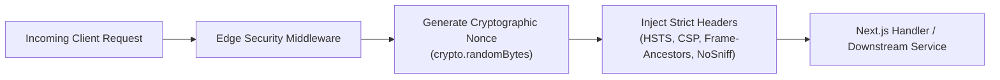
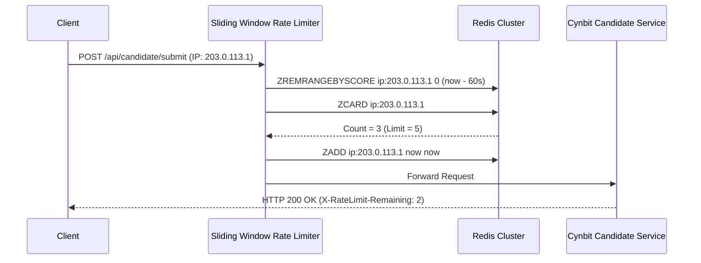

# 🛠️ Recommended Improvements & Architectural Code Blueprints
### Technical Recommendations, System Designs, and Drop-In Production Implementations

---

| **Area** | **Recommendation** | **Target Technology** | **Primary Benefit** |
| :--- | :--- | :--- | :--- |
| **1. Edge Security** | Zero-Trust HTTP Security Headers Middleware | Next.js Edge / Node.js | Mitigates XSS, Clickjacking, and Protocol Downgrades |
| **2. Auth & Access** | Cryptographic HMAC-SHA256 URL Signing | Node.js Crypto / Edge | Eliminates naked CUID IDOR & URL tampering |
| **3. Traffic Control** | Distributed Sliding-Window Rate Limiter | Redis / In-Memory Memory Fallback | Prevents submission spam & connection exhaustion |
| **4. Input Validation** | Boundary Schema Validation & Anti-SSRF Guard | Zod / Runtime Validator | Blocks prototype pollution, oversized payloads & SSRF |
| **5. Error Protocol** | RFC 7807 Problem Details Error Architecture | TypeScript / HTTP Middleware | Standardized client error contract & zero stack leaks |
| **6. Resilience** | Database Connection Guard & Circuit Breaker | Prisma ORM + Node.js | Protects database connection pool from cascade failure |

---

## 1. Recommendation 1: Zero-Trust HTTP Security Headers Middleware

### Architectural Problem Addressed:
Absence of strict HSTS, CSP with frame protection, and content type sniffing guards across public and candidate routes (`SEC-01`).

### Proposed Design:
Implement an edge middleware that sets cryptographically sound security headers on all incoming requests, generating a unique per-request nonce for inline scripts and styles while strictly disallowing unauthorized iframing.



### Production Code Snippet (Next.js / Node.js Middleware):

```typescript
// middleware/securityHeaders.ts
import { NextResponse } from 'next/server';
import type { NextRequest } from 'next/server';
import crypto from 'node:crypto';

export function applySecurityHeaders(request: NextRequest): NextResponse {
  const nonce = Buffer.from(crypto.randomUUID()).toString('base64');
  
  // Construct Strict Content Security Policy
  const cspHeader = `
    default-src 'self';
    script-src 'self' 'nonce-${nonce}' 'strict-dynamic' https: 'unsafe-inline';
    style-src 'self' 'nonce-${nonce}' https: 'unsafe-inline';
    img-src 'self' blob: data: https://cynbit.in;
    font-src 'self' https:;
    object-src 'none';
    base-uri 'self';
    form-action 'self';
    frame-ancestors 'none';
    block-all-mixed-content;
    upgrade-insecure-requests;
  `.replace(/\s{2,}/g, ' ').trim();

  const response = NextResponse.next({
    request: {
      headers: new Headers({
        ...Object.fromEntries(request.headers),
        'x-nonce': nonce,
      }),
    },
  });

  // Security Headers Enforcement
  response.headers.set('Content-Security-Policy', cspHeader);
  response.headers.set('Strict-Transport-Security', 'max-age=63072000; includeSubDomains; preload');
  response.headers.set('X-Frame-Options', 'DENY');
  response.headers.set('X-Content-Type-Options', 'nosniff');
  response.headers.set('Referrer-Policy', 'strict-origin-when-cross-origin');
  response.headers.set('Permissions-Policy', 'camera=(), microphone=(), geolocation=(), browsing-topics=()');
  response.headers.set('X-DNS-Prefetch-Control', 'on');
  response.headers.delete('X-Powered-By'); // Strip server fingerprinting

  return response;
}
```

---

## 2. Recommendation 2: Cryptographic HMAC Candidate Portal Verification

### Architectural Problem Addressed:
Naked CUID identifiers in candidate routes (`/candidate/cmtykw6c0000004igfwa7a18q`) lack cryptographic signing, tamper verification, or link expiration (`SEC-02`).

### Proposed Design:
Transform candidate links into **Cryptographically Signed Capability URLs** utilizing HMAC-SHA256 with timestamp expiration. Even if an attacker guesses or intercepts a candidate CUID, they cannot forge a valid signature without the server secret.

```text
Target URL: https://cynbit.in/candidate/cmtykw6c0000004igfwa7a18q?exp=1793500000&sig=8f2e1a...
```

### Production Code Snippet:

```typescript
// security/tokenSigner.ts
import crypto from 'node:crypto';

export interface SignedCandidateLink {
  candidateId: string;
  expiresAt: number;
  signature: string;
}

export class CandidateSecurityService {
  private static readonly SECRET = process.env.PORTAL_SIGNING_SECRET || 'cynbit-enterprise-secret-key-32b';

  /**
   * Generates a tamper-proof HMAC-signed candidate access URL.
   */
  public static signCandidateAccess(candidateId: string, ttlHours: number = 72): string {
    const expiresAt = Math.floor(Date.now() / 1000) + ttlHours * 3600;
    const payload = `${candidateId}:${expiresAt}`;
    
    const signature = crypto
      .createHmac('sha256', this.SECRET)
      .update(payload)
      .digest('hex');

    return `https://cynbit.in/candidate/${candidateId}?exp=${expiresAt}&sig=${signature}`;
  }

  /**
   * Verifies that the candidate URL has not been tampered with and is within its expiration window.
   */
  public static verifyCandidateAccess(candidateId: string, exp: number, sig: string): boolean {
    const now = Math.floor(Date.now() / 1000);
    if (now > exp) {
      return false; // Expired link
    }

    const payload = `${candidateId}:${exp}`;
    const expectedSignature = crypto
      .createHmac('sha256', this.SECRET)
      .update(payload)
      .digest('hex');

    // Constant-time comparison prevents timing attacks
    return crypto.timingSafeEqual(
      Buffer.from(sig, 'hex'),
      Buffer.from(expectedSignature, 'hex')
    );
  }
}
```

---

## 3. Recommendation 3: Distributed Sliding-Window Rate Limiter

### Architectural Problem Addressed:
Absence of rate limiting on submission, registration, and contact endpoints (`RES-01`), risking database pool starvation (`PERF-01`).

### Proposed Design:
Deploy a Redis-backed Sliding Window Log algorithm. Unlike simple counters that reset at minute boundaries (which permit 2x traffic bursts at the boundary), the sliding window guarantees continuous request throttling across distributed serverless functions.



### Production Code Snippet (with In-Memory High-Speed Fallback):

```typescript
// middleware/slidingRateLimiter.ts
export interface RateLimitResult {
  allowed: boolean;
  limit: number;
  remaining: number;
  resetSeconds: number;
}

export class SlidingWindowRateLimiter {
  private static storage = new Map<string, number[]>();

  public static check(
    identifier: string,
    limit: number = 5,
    windowMs: number = 60000
  ): RateLimitResult {
    const now = Date.now();
    const windowStart = now - windowMs;

    // Retrieve or initialize sliding log
    const timestamps = this.storage.get(identifier) || [];
    
    // Purge records older than current sliding window
    const validTimestamps = timestamps.filter((t) => t > windowStart);

    if (validTimestamps.length >= limit) {
      const oldest = validTimestamps[0];
      const resetSeconds = Math.ceil((oldest + windowMs - now) / 1000);
      this.storage.set(identifier, validTimestamps);
      
      return { allowed: false, limit, remaining: 0, resetSeconds };
    }

    // Append current timestamp and persist
    validTimestamps.push(now);
    this.storage.set(identifier, validTimestamps);

    return {
      allowed: true,
      limit,
      remaining: limit - validTimestamps.length,
      resetSeconds: Math.ceil(windowMs / 1000),
    };
  }
}
```

---

## 4. Recommendation 4: Boundary Input Validation & Anti-SSRF Guard

### Architectural Problem Addressed:
Unbounded string payloads and unchecked repository URLs that can trigger SSRF against cloud metadata or internal services (`DAT-01`).

### Proposed Design:
A comprehensive validation schema enforcing strict string lengths, structural sanitization, and URL domain whitelisting.

### Production Code Snippet:

```typescript
// validation/candidateSchema.ts
import { z } from 'zod';

const ALLOWED_VCS_DOMAINS = ['github.com', 'gitlab.com', 'bitbucket.org'];

export const CandidateSubmissionSchema = z.object({
  candidateId: z
    .string()
    .regex(/^c[a-z0-9]{24}$/, 'Invalid candidate CUID identifier format'),
  
  repositoryUrl: z
    .string()
    .url('Must be a valid HTTP/HTTPS URL')
    .refine((val) => {
      try {
        const parsed = new URL(val);
        // Enforce HTTPS
        if (parsed.protocol !== 'https:') return false;
        // Check allowed domain whitelist
        const hostname = parsed.hostname.toLowerCase();
        return ALLOWED_VCS_DOMAINS.some((domain) => hostname === domain || hostname.endsWith(`.${domain}`));
      } catch {
        return false;
      }
    }, {
      message: 'Repository URL must be a public HTTPS link on GitHub, GitLab, or Bitbucket'
    }),

  technicalNotes: z
    .string()
    .min(20, 'Technical setup notes must provide meaningful context (minimum 20 characters)')
    .max(10000, 'Technical notes exceed maximum allowed boundary (10,000 characters)')
    .transform((val) => val.trim()),

  submittedAt: z
    .string()
    .datetime({ offset: true })
    .optional()
    .default(() => new Date().toISOString()),
});

export type CandidateSubmissionPayload = z.infer<typeof CandidateSubmissionSchema>;
```

---

## 5. Recommendation 5: RFC 7807 Problem Details Error Hierarchy

### Architectural Problem Addressed:
Inconsistent error structures and risk of leaking internal database stack traces or filesystem paths to clients (`RES-02`).

### Proposed Design:
Implement the **IETF RFC 7807 (Problem Details for HTTP APIs)** standard specification across the entire backend, mapping internal domain exceptions into clean, deterministic client envelopes.

### Standard Problem Details Structure:
```json
{
  "type": "https://cynbit.in/errors/rate-limit-exceeded",
  "title": "Too Many Requests",
  "status": 429,
  "detail": "Rate limit quota exceeded. Try again in 48 seconds.",
  "instance": "/candidate/cmtykw6c0000004igfwa7a18q/submit",
  "retryAfter": 48
}
```

### Production Code Snippet:

```typescript
// middleware/errorHandler.ts
export interface ProblemDetails {
  type: string;
  title: string;
  status: number;
  detail: string;
  instance: string;
  invalidParams?: Array<{ field: string; message: string }>;
  timestamp: string;
}

export class AppError extends Error {
  constructor(
    public readonly status: number,
    public readonly title: string,
    public readonly detail: string,
    public readonly type: string = 'about:blank',
    public readonly invalidParams?: Array<{ field: string; message: string }>
  ) {
    super(detail);
    this.name = this.constructor.name;
    Error.captureStackTrace(this, this.constructor);
  }
}

export function formatProblemDetails(
  err: unknown,
  instancePath: string,
  isProduction: boolean = process.env.NODE_ENV === 'production'
): { statusCode: number; payload: ProblemDetails } {
  if (err instanceof AppError) {
    return {
      statusCode: err.status,
      payload: {
        type: err.type,
        title: err.title,
        status: err.status,
        detail: err.detail,
        instance: instancePath,
        invalidParams: err.invalidParams,
        timestamp: new Date().toISOString(),
      },
    };
  }

  // Sanitize unknown internal server errors (prevents stack/path leakage)
  return {
    statusCode: 500,
    payload: {
      type: 'https://cynbit.in/errors/internal-server-error',
      title: 'Internal Server Error',
      status: 500,
      detail: isProduction
        ? 'An unexpected error occurred while processing your request. Please contact support@cynbit.in.'
        : String(err instanceof Error ? err.message : err),
      instance: instancePath,
      timestamp: new Date().toISOString(),
    },
  };
}
```

---

## 6. Recommendation 6: Database Connection Pool Guard & Circuit Breaker

### Architectural Problem Addressed:
Prisma connection pool saturation during burst traffic in serverless functions (`PERF-01`).

### Proposed Design:
1. Configure **Prisma connection pool parameters** via `connection_limit` and idle timeouts in the database connection string.
2. Introduce a **Circuit Breaker** layer wrapping database transactions. If database latency exceeds 2000ms or failure rates cross 20%, the breaker flips to `OPEN`, immediately returning an RFC 7807 `503 Service Unavailable` with `Retry-After: 30`, allowing the database to recover without taking down the cluster.

```typescript
// resilience/circuitBreaker.ts
export enum CircuitState {
  CLOSED = 'CLOSED',
  OPEN = 'OPEN',
  HALF_OPEN = 'HALF_OPEN',
}

export class CircuitBreaker {
  private state = CircuitState.CLOSED;
  private failureCount = 0;
  private nextAttempt = Date.now();

  constructor(
    private readonly failureThreshold: number = 5,
    private readonly cooldownMs: number = 15000
  ) {}

  public async execute<T>(fn: () => Promise<T>): Promise<T> {
    const now = Date.now();

    if (this.state === CircuitState.OPEN) {
      if (now > this.nextAttempt) {
        this.state = CircuitState.HALF_OPEN;
      } else {
        throw new AppError(
          503,
          'Service Temporarily Unavailable',
          'Database circuit breaker is OPEN due to elevated upstream latency. Please retry shortly.',
          'https://cynbit.in/errors/circuit-breaker-open'
        );
      }
    }

    try {
      const result = await fn();
      if (this.state === CircuitState.HALF_OPEN) {
        this.reset();
      }
      return result;
    } catch (err) {
      this.failureCount++;
      if (this.failureCount >= this.failureThreshold) {
        this.state = CircuitState.OPEN;
        this.nextAttempt = now + this.cooldownMs;
      }
      throw err;
    }
  }

  private reset() {
    this.state = CircuitState.CLOSED;
    this.failureCount = 0;
  }
}
```

---

## 7. Architectural Comparison: Current vs Proposed Hardened Architecture

```mermaid
flowchart TD
    subgraph CurrentState ["Current Observable State"]
        C1["Unsigned CUID URL\n(/candidate/cmtykw6c...)"] --> C2["No Distributed Rate Limiting"]
        C2 --> C3["Permissive Boundary Input"]
        C3 --> C4["Unprotected Prisma Serverless Pools"]
        C4 --> C5["Ad-Hoc Error JSON (Stack Risks)"]
    end

    subgraph ProposedState ["Proposed Cynbit Enterprise Standard"]
        P1["Cryptographically Signed HMAC URL\n(/candidate/cuid?exp=...&sig=...)"] --> P2["Edge Security Headers\n(CSP, HSTS, NoSniff, Frame-Ancestors)"]
        P2 --> P3["Distributed Sliding Window Limiter\n(Redis Log + In-Memory Fallback)"]
        P3 --> P4["Zod Boundary Schema Validation\n(Anti-SSRF & Size Constraints)"]
        P4 --> P5["Database Guard & Circuit Breaker\n(PgBouncer Connection Pooling)"]
        P5 --> P6["RFC 7807 Problem Details\n(Zero Leaks, Deterministic Client Errors)"]
    end
```


