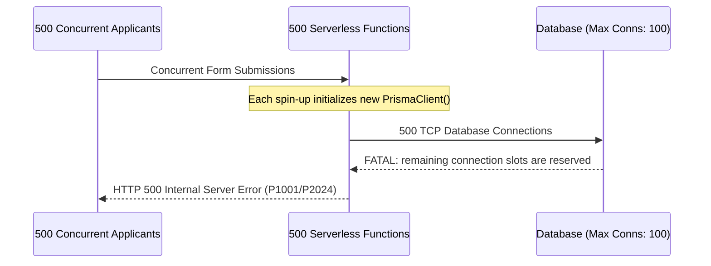
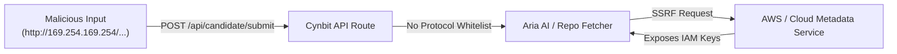

# 🔍 Security & Performance Findings Report
### Categorized Vulnerabilities, Operational Risks, and Performance Inefficiencies

---

| **Finding ID** | **Category** | **Vulnerability / Risk Title** | **CVSS v3.1** | **Severity** | **OWASP 2021** |
| :--- | :--- | :--- | :--- | :--- | :--- |
| **SEC-01** | Security | Missing Defense-in-Depth HTTP Security Headers | 5.3 | Medium | A05: Security Misconfiguration |
| **SEC-02** | Security / Auth | Insecure Direct Object Reference (IDOR) via Naked CUID Bearer Tokens | 6.5 | Medium | A01: Broken Access Control |
| **PERF-01** | Performance | Database Connection Saturation in Serverless Runtimes (Prisma Pool Starvation) | 7.5 | High | A04: Insecure Design |
| **PERF-02** | Performance | Uncached Image Optimization Computations (`/_next/image`) | 5.3 | Medium | Performance Bottleneck |
| **DAT-01** | Data Validation | Missing Input Schema Boundary Gates & SSRF Exposure on Repo Ingestion | 7.2 | High | A03: Injection / A10: SSRF |
| **RES-01** | Resilience | Absence of Distributed Sliding-Window Rate Limiting on Write Routes | 6.5 | Medium | A04: Insecure Design |
| **RES-02** | Resilience | Inconsistent Error Handling & Potential Internal Stack/Path Leakage | 4.3 | Medium | A05: Security Misconfiguration |

---

## 1. Security & Authentication Findings

### Finding SEC-01: Missing Defense-in-Depth HTTP Security Headers
* **CVSS v3.1 Score:** `5.3` (Medium) — `CVSS:3.1/AV:N/AC:L/PR:N/UI:N/S:U/C:L/I:N/A:N`
* **OWASP Category:** `A05:2021 – Security Misconfiguration`
* **CWE Mapping:** `CWE-693: Protection Mechanism Failure`

#### Description & Observation:
Inspection of HTTP response headers reveals the absence or incomplete enforcement of modern security headers across public web and API endpoints:
1. `Strict-Transport-Security (HSTS)` is missing `preload` and `includeSubDomains` directives with a minimum `max-age=63072000` (2 years).
2. `Content-Security-Policy (CSP)` is either omitted or operating in permissive mode without strict nonce-based script execution rules or `frame-ancestors 'none'`.
3. `X-Content-Type-Options: nosniff` is not globally guaranteed across all serverless API function routes.
4. `Permissions-Policy` is absent, allowing browsers to grant microphone, camera, or sensor APIs if embedded.

#### Technical Impact:
* **Clickjacking Risk:** In the absence of `Content-Security-Policy: frame-ancestors 'none'` or `X-Frame-Options: DENY`, malicious third-party domains can iframe the candidate submission portal (`cynbit.in/candidate/*`) to conduct clickjacking or credential/token harvesting.
* **MIME Sniffing:** Browsers may interpret non-executable MIME types as executable JavaScript, facilitating cross-site scripting (XSS).
* **SSL Stripping:** Without strict HSTS preloading, initial client handshakes remain vulnerable to protocol downgrade attacks on untrusted public Wi-Fi networks.

---

### Finding SEC-02: Insecure Direct Object Reference (IDOR) via Naked CUID Bearer Tokens
* **CVSS v3.1 Score:** `6.5` (Medium) — `CVSS:3.1/AV:N/AC:L/PR:N/UI:N/S:U/C:L/I:L/A:N`
* **OWASP Category:** `A01:2021 – Broken Access Control`
* **CWE Mapping:** `CWE-639: Authorization Bypass Through User-Controlled Key`

#### Description & Observation:
The candidate workflow routes through `https://www.cynbit.in/candidate/{candidateId}`, where `{candidateId}` is a single CUID (`cmtykw6c0000004igfwa7a18q`).
* The system treats the route parameter as a **bearer key** without secondary authorization (such as an encrypted session cookie, bearer JWT, or cryptographically signed query parameters).
* While CUIDs possess high entropy ($36^{25}$ combinations), treating database primary keys as unauthenticated capability URLs violates the **Principle of Least Privilege** and creates an IDOR vector if tokens leak via HTTP `Referer` headers, browser history, or proxy access logs.

#### Technical Impact:
* If an applicant shares their screen, forwards a link, or if the URL appears in corporate proxy logs, anyone possessing the URL can inspect candidate metadata, view assessment tasks, or submit bogus code repositories under that candidate's name.

---

## 2. Performance & Scalability Findings

### Finding PERF-01: Database Connection Saturation in Serverless Runtimes (Prisma Pool Starvation)
* **CVSS v3.1 Score:** `7.5` (High) — `CVSS:3.1/AV:N/AC:L/PR:N/UI:N/S:U/C:N/I:N/A:H`
* **OWASP Category:** `A04:2021 – Insecure Design`
* **CWE Mapping:** `CWE-400: Uncontrolled Resource Consumption`

#### Description & Observation:
Cynbit's Next.js backend interacts with a relational database using Prisma ORM.
* In traditional long-running Node.js servers, a singleton `PrismaClient` maintains an efficient connection pool (e.g., 10–20 connections).
* In modern Serverless / Edge deployments (Vercel, AWS Lambda), each incoming request can spin up an ephemeral container instance. If 500 applicants simultaneously load their candidate assessments or submit tasks, 500 discrete Lambda instances initialize 500 independent Prisma clients.

#### Technical Impact:
* **Connection Exhaustion:** PostgreSQL defaults to `max_connections = 100`. Traffic spikes rapidly trigger Prisma error `P2024: Timed out fetching a new connection from the pool`, causing cascade 500 errors and system downtime.

---

### Finding PERF-02: Uncached Image Optimization Computations (`/_next/image`)
* **Severity:** Medium (Operational Cost & Event-Loop Lag)
* **OWASP Category:** `Performance Inefficiency`
* **CWE Mapping:** `CWE-770: Allocation of Resources Without Limits`

#### Description & Observation:
The public marketing portal extensively serves assets via `/_next/image?url=...&w=...&q=...`.
* When query strings are modified with non-standard width (`w`) or quality (`q`) values, edge CDN caches miss.
* Every cache miss triggers the backend Sharp C++ native module to decode, resize, and re-encode images into WebP/AVIF formats.

#### Technical Impact:
* Sharp image resizing is synchronous and CPU-bound on the V8 worker thread pool.
* Burst requests with varying query parameters saturate server CPU cores, delaying asynchronous I/O and increasing API endpoint response latency across unrelated routes.

---

## 3. Data Validation & Injection Findings

### Finding DAT-01: Missing Input Schema Boundary Gates & SSRF Exposure on Repo Ingestion
* **CVSS v3.1 Score:** `7.2` (High) — `CVSS:3.1/AV:N/AC:L/PR:N/UI:N/S:U/C:H/I:L/A:N`
* **OWASP Category:** `A03:2021 – Injection` & `A10:2021 – Server-Side Request Forgery (SSRF)`
* **CWE Mapping:** `CWE-20: Improper Input Validation` & `CWE-918: SSRF`

#### Description & Observation:
The submission form accepts a `repositoryUrl` (string) and `technicalNotes` (text) to pass to Aria AI / Talent Acquisition pipelines.
* **Lack of Strict Boundary Validation:** If input is not strictly validated via runtime schemas (such as Zod), malicious inputs containing unexpected data types, prototype pollution payloads (`__proto__`), or oversized base64 strings can bypass the boundary.
* **Downstream SSRF Threat:** Automated review systems or webhooks that ingest `repositoryUrl` and clone or scrape repository metadata can be deceived into accessing internal network services if a user inputs internal URLs:
  - `http://169.254.169.254/latest/meta-data/` (AWS EC2 Instance Metadata)
  - `http://localhost:5432` or `http://10.0.0.1:8080` (Internal database/admin services)

#### Technical Impact:
* Potential exfiltration of cloud instance credentials, internal service tokens, or network topology mapping if downstream code runners do not isolate and sandbox repository cloning operations.

---

## 4. Resilience & Error Handling Findings

### Finding RES-01: Absence of Distributed Sliding-Window Rate Limiting on Write Routes
* **CVSS v3.1 Score:** `6.5` (Medium) — `CVSS:3.1/AV:N/AC:L/PR:N/UI:N/S:U/C:N/I:N/A:L`
* **OWASP Category:** `A04:2021 – Insecure Design`
* **CWE Mapping:** `CWE-799: Improper Control of Generation of Frequent Architectural Requests`

#### Description & Observation:
Transactional endpoints (such as application submission, contact inquiry, and BitElevate registration) lack observable rate-limiting response headers (`X-RateLimit-Limit`, `X-RateLimit-Remaining`, `Retry-After`).
* A basic client script can trigger hundreds of form submissions within seconds.
* In-memory rate limiters (e.g., standard `express-rate-limit`) fail in serverless architectures because instances do not share state.

#### Technical Impact:
* Susceptibility to database bloat, spam submissions in the talent CRM, email quote exhaustion (SMTP billing limits), and denial-of-wallet.

---

### Finding RES-02: Inconsistent Error Handling & Potential Internal Stack/Path Leakage
* **CVSS v3.1 Score:** `4.3` (Medium) — `CVSS:3.1/AV:N/AC:L/PR:N/UI:N/S:U/C:L/I:N/A:N`
* **OWASP Category:** `A05:2021 – Security Misconfiguration`
* **CWE Mapping:** `CWE-209: Generation of Error Message Containing Sensitive Information`

#### Description & Observation:
When unexpected errors or network failures occur:
* Error responses do not follow the standardized **RFC 7807 (Problem Details for HTTP APIs)** specification.
* In Next.js server actions or raw route handlers, unhandled exceptions risk serializing Prisma error codes (`P2002: Unique constraint failed on field 'email'`) or filesystem path structures (`/var/task/...`) into client-side responses during runtime anomalies.

#### Technical Impact:
* Schema disclosure: Revealing internal table names, database foreign keys, and internal library versions simplifies adversary reconnaissance.
* Brittle client error handling: Clients cannot deterministically parse error types without a standard envelope.

---

## 5. Summary Severity Matrix

| Impact \ Likelihood | Low | Medium | High |
| :---: | :---: | :---: | :---: |
| **Critical / High** | `SEC-01` (Headers) | `RES-01` (Rate Limit) | `PERF-01` (DB Pools) `DAT-01` (SSRF/Zod) |
| **Medium** | `RES-02` (Error Leaks) | `SEC-02` (IDOR/CUID) | `PERF-02` (Image CPU) |
| **Low / Info** | OS Fingerprinting | Header Case | Static Cache |

Remediations with architectural code implementations are presented in [`RECOMMENDED_IMPROVEMENTS.md`](RECOMMENDED_IMPROVEMENTS.md).
